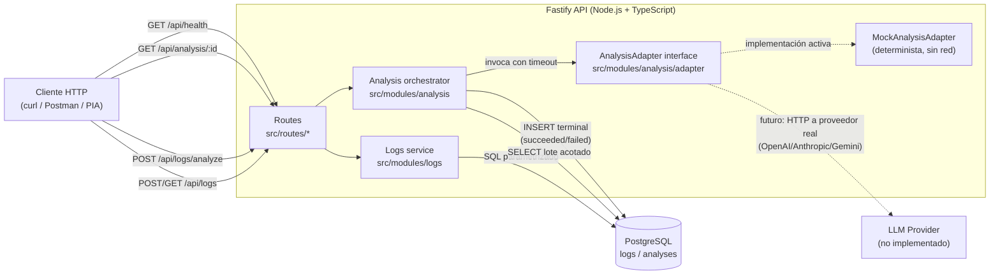
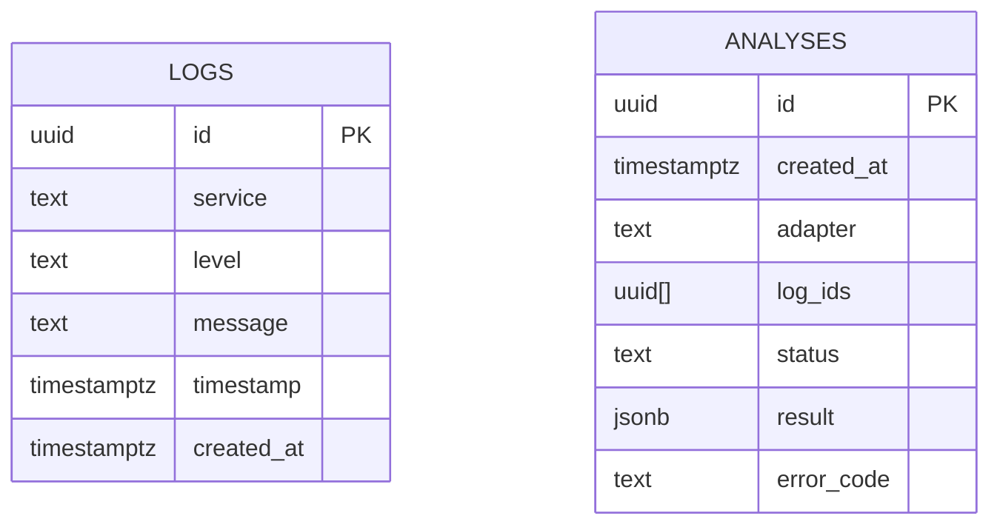

# ARCHITECTURE.md — SmartLog Analyzer

Prototipo interno para ingestar logs de varios microservicios, consultarlos y generar
análisis (resumen, categorías, sugerencias) a partir de un lote acotado, usando un
adaptador de IA intercambiable.

> **Nota sobre el historial:** el primer commit de este repo exploró un diseño
> asincrónico (cola con `SKIP LOCKED`, `202` + polling, errores RFC 9457). Se
> descartó por priorizar un flujo más simple y verificable dentro del tiempo
> disponible: análisis síncrono con timeout acotado, persistencia terminal única y
> errores en un formato propio más chico. Esa exploración queda disponible en la
> rama `stage-1-walking-skeleton` como referencia, sin mergear a `main`. Esta
> versión del documento es la fuente de verdad vigente.

## 1. Componentes y flujo de datos



Puntos clave del flujo:

- **El adaptador nunca escribe en la base.** Solo el orquestador de análisis hace el
  `INSERT` terminal, y lo hace una única vez por intento aceptado. Esto evita que una
  respuesta tardía de un adaptador que ignoró el `AbortSignal` pise un resultado ya
  persistido (ver §6).
- **Ingesta y consulta** son CRUD simple sobre `logs`, sin pasar por el adaptador.
- **Análisis** es un paso síncrono: el cliente espera la respuesta HTTP con el
  resultado ya persistido (201) o el fallo ya persistido (502/504 con el ID consultable).

## 2. Modelo de datos



- `logs.level` restringido por `CHECK` a `DEBUG | INFO | WARN | ERROR`.
- `logs.timestamp` es `timestamptz`: se recibe con offset/zona explícita y se
  normaliza a UTC al guardar y al responder.
- `analyses.status` restringido por `CHECK` a `succeeded | failed`. No existe estado
  `pending`: el endpoint es síncrono, así que una fila de `analyses` solo se crea
  cuando el intento ya terminó (éxito o fallo terminal).
- `analyses.log_ids` guarda los IDs exactos de los logs que formaron el lote
  analizado (array acotado a ≤100 elementos), para poder auditar qué evidencia
  sustenta un resultado sin necesitar una tabla intermedia (ver alternativas, §5).
- `analyses.result` es `JSONB` cuando `status = 'succeeded'` y `NULL` cuando
  `status = 'failed'`; en ese caso `error_code` guarda un código seguro
  (`ADAPTER_ERROR` | `ADAPTER_TIMEOUT` | `INVALID_ADAPTER_OUTPUT`), nunca el mensaje
  crudo del proveedor.
- Índices: `logs(service, level, timestamp DESC)` para soportar filtros combinados +
  orden de listado; `logs(timestamp DESC, id DESC)` para el caso sin filtros;
  `analyses(created_at DESC)` para listados administrativos futuros (no expuestos
  todavía, documentado como extensión).

## 3. Contrato HTTP

| Método | Ruta | Éxito | Errores |
|---|---|---|---|
| `POST` | `/api/logs` | `201` + log creado | `400` validación |
| `GET` | `/api/logs` | `200` + lista (incluso vacía) | `400` filtros inválidos |
| `POST` | `/api/logs/analyze` | `201` + resultado + `Location` | `422` lote vacío/excedido, `502` adaptador, `504` timeout |
| `GET` | `/api/analysis/:id` | `200` (succeeded o failed) | `400` ID inválido, `404` no existe |
| `GET` | `/api/health` | `200` DB ok | `503` DB no responde |

Reglas transversales:

- Errores siempre `{ "error": { "code": "...", "message": "..." } }`, sin stack
  traces ni detalles internos del adaptador o de PostgreSQL.
- `GET /api/logs`: filtros `service`, `level`, `from`, `to`, `limit`. Intervalo
  `[from, to)` semiabierto (evita doble conteo en consultas consecutivas). Salida en
  UTC (`toISOString`). Orden `timestamp DESC, id DESC` (estable aun con timestamps
  duplicados). `limit` por defecto 50, máximo 500 — documentado en README, sin
  paginación por cursor (extra opcional, fuera de alcance, ver §5).
- `POST /api/logs/analyze`: `from`/`to` obligatorios, `service`/`level` opcionales.
  Selección determinista (mismo orden que el listado) de hasta 101 filas: si la
  fila 101 existe, el lote excede el límite documentado de 100 y se responde `422`
  sin tocar el adaptador. También `422` si el lote resulta vacío, o si el tamaño
  serializado del lote supera el límite de bytes documentado (protege al adaptador
  mock y a un proveedor real de payloads desproporcionados).

## 4. Integración con IA — adaptador mock y camino a producción

`AnalysisAdapter` es una interfaz mínima:

```ts
interface AnalysisAdapter {
  readonly name: string;
  analyze(input: { logs: LogRecord[] }, signal: AbortSignal): Promise<AnalysisOutput>;
}
```

- **Implementación activa:** `MockAnalysisAdapter`, determinista: agrupa el lote por
  `service`/`level`, deriva `summary` (texto generado a partir de los conteos reales),
  `categories` (p. ej. `connection_errors`, `timeout`, `validation`, agrupadas por
  coincidencia de patrones en `message`) y `suggestions` (reglas simples ligadas a
  las categorías detectadas). Sin hallazgos → `categories: []` y un `summary`
  explícito de "sin anomalías detectadas", no un array vacío silencioso.
- **Validación en runtime:** la salida del adaptador (mock o real) se valida contra
  un esquema antes de persistir: tipos de `summary`/`categories`/`suggestions`,
  cantidades razonables, y que **cada ID de evidencia citado pertenezca al lote**
  enviado (si el adaptador "alucina" un ID fuera del lote, se trata como salida
  inválida → `502`).
- **Camino a un proveedor real:** se agrega un `HttpLlmAdapter` que implementa la
  misma interfaz, construye el prompt con los logs serializados y una instrucción de
  sistema separada, llama al proveedor (OpenAI/Anthropic/Gemini) con la API key desde
  variable de entorno, y parsea/valida la respuesta con el mismo validador de
  esquema. El `AnalysisOrchestrator` no cambia: solo cambia qué adaptador se inyecta
  (factory por variable de entorno `ANALYSIS_ADAPTER=mock|http`).
- **Datos sensibles:** los logs pueden contener fragmentos de PII o secretos
  filtrados por error. Documentado en README: (a) nunca se envían logs `DEBUG` sin
  revisión, (b) se recomienda un paso de *redacción* (regex para emails, tokens tipo
  `Bearer ...`, IPs) antes de serializar el lote hacia un proveedor real — no
  implementado en el mock porque no sale de proceso, pero sí queda como requisito
  documentado del `HttpLlmAdapter`.
- **Separar instrucciones de datos no confiables:** el prompt real usaría un mensaje
  de sistema fijo (las instrucciones) y pasaría los logs como un bloque de datos
  claramente delimitado (p. ej. JSON en un mensaje de rol `user` separado, nunca
  concatenado a la instrucción). Esto evita que un `message` de log con texto tipo
  "ignore previous instructions" sea interpretado como instrucción por el LLM. El
  validador de esquema de salida es la segunda barrera: cualquier intento de
  inyección que no respete el esquema o cite IDs fuera del lote se descarta como
  `502 INVALID_ADAPTER_OUTPUT`.

## 5. Decisiones técnicas y alternativas descartadas

| Decisión | Alternativa descartada | Motivo |
|---|---|---|
| Node.js 24 LTS + TypeScript + Fastify 5 | Java + Spring Boot | Mayor velocidad de desarrollo en el tiempo disponible (10–15 h); Fastify da validación por esquema y bajo overhead sin boilerplate de Spring. |
| PostgreSQL 17 + `pg` con SQL parametrizado | Prisma/TypeORM, o SQLite | SQL explícito hace auditable cada query (relevante para la defensa técnica); evita la "caja negra" de un ORM. SQLite se descartó porque el enunciado pide un modelo relacional con agregación, y Postgres es el estándar de facto para microservicios reales. |
| Monolito modular (un proceso, módulos `logs`/`analysis` separados) | Microservicios separados (logs-service, analysis-service) | El alcance (un prototipo, 5 endpoints) no justifica la complejidad operativa de red/descubrimiento entre servicios. Separación lógica por módulo ya da el aislamiento necesario para testear y defender cada pieza. |
| Análisis síncrono con timeout acotado | Cola (BullMQ/SQS) + worker asíncrono con `202`/polling | Un flujo de cola es más robusto para proveedores lentos reales, pero agrega infraestructura (estado `pending`, locking, polling) que no es defendible en el tiempo disponible. Se exploró en el primer commit del repo y se descartó por esa razón (ver nota al inicio de este documento). Documentado como evolución natural si el proveedor real introduce latencia alta. |
| Adaptador mock determinista detrás de interfaz `AnalysisAdapter` | Proveedor real (OpenAI/Anthropic) en el flujo principal | El enunciado lo permite explícitamente. Mock determinista permite que el evaluador reproduzca la demo sin red ni API key, y las pruebas de timeout/formato inesperado son deterministas en CI. La interfaz deja el cambio a un proveedor real como una sola pieza intercambiable. |
| `analyses.result` como `JSONB` + `log_ids uuid[]` | Tablas normalizadas por categoría/sugerencia, tabla intermedia `analysis_logs` | El resultado se consulta siempre completo por ID (no hay queries relacionales sobre categorías individuales en el alcance actual). Un array acotado a ≤100 IDs es más simple que una tabla intermedia y no genera N+1. Si se agrega retención/borrado de logs analizados, esta decisión se revisa (el array no tiene integridad referencial). |
| Timeout propio con `setTimeout` + `Promise.race`, limpieza garantizada | Confiar únicamente en `AbortSignal` | El enunciado exige que el timeout resuelva aun si el adaptador ignora la señal de aborto. Se usa `Promise.race` entre la promesa del adaptador y un temporizador; se propaga `AbortSignal` igual (buenas prácticas / proveedores reales sí lo respetan), pero el temporizador es la garantía dura. El temporizador se limpia en ambos casos para no dejar handles colgados. |
| Vitest | Jest | Arranque más rápido con TS nativo (sin `ts-jest`/Babel), API compatible con Jest (baja fricción), y mejor soporte ESM — relevante porque el proyecto usa TypeScript con `"module": "NodeNext"`. |
| Sin paginación por cursor en `GET /api/logs` (solo `limit`) | Cursor/keyset pagination | Listado en el enunciado es "con filtros", no pagineado explícitamente. `limit` acotado + orden estable es suficiente para el prototipo; cursor queda documentado como extra no implementado. |
| Errores propios `{error:{code,message}}` | RFC 9457 (`application/problem+json`) | Un formato propio chico es más rápido de implementar y de testear exhaustivamente en el tiempo disponible; RFC 9457 es más estándar pero agrega campos (`type`, `title`, `instance`) que no aportan en un prototipo de 5 endpoints. Se documenta como mejora natural si la API crece. |
| Sin CI | GitHub Actions | El enunciado marca CI como extra opcional condicionado a que "lo obligatorio ya funcione". Se agrega solo si sobra tiempo tras Etapa 4. |

## 6. Fallos, reintentos y qué pasa si el proceso cae

- **Caída del proceso entre el `SELECT` del lote y el `INSERT` terminal:** el intento
  se pierde sin dejar fila en `analyses` (no hay estado intermedio `pending`
  persistido). El cliente recibe un error de conexión/timeout de red, no una
  respuesta HTTP del servidor. Es seguro reintentar el mismo `POST
  /api/logs/analyze`: como no quedó fila, no hay duplicado posible.
- **El cliente repite el `POST` después de perder la respuesta pero el servidor sí
  llegó a persistir:** hoy esto puede crear dos filas `analyses` distintas para el
  mismo lote lógico (no hay idempotencia). Documentado como limitación del
  prototipo: la evolución natural es aceptar una `Idempotency-Key` del cliente y
  usar un `UNIQUE` sobre esa clave, o derivar una clave determinista de
  `(from, to, service, level, log_ids)` con `ON CONFLICT DO NOTHING` + lectura del
  existente.
- **Fallo al escribir en PostgreSQL** (no al adaptador): se responde un error de
  infraestructura (`500`) sin ID, porque no se puede prometer que el resultado sea
  consultable después. Distinto del fallo del adaptador (`502`/`504`), que si logra
  persistirse sí expone su ID.
- **Respuesta tardía de un adaptador que ignoró `AbortSignal`:** el orquestador ya
  resolvió por timeout y ya hizo su único `INSERT`. La promesa tardía del adaptador,
  cuando finalmente resuelve o rechaza, se ignora explícitamente (no hay un segundo
  `INSERT`/`UPDATE`); se loguea para observabilidad pero no muta estado.

## 7. Matriz requisito → implementación → verificación

| Requisito (desafío) | Implementación prevista | Verificación |
|---|---|---|
| Diagrama de arquitectura + decisiones | §1 y §5 de este documento | Revisión humana (esta pausa de Etapa 0) |
| Modelo de datos logs/analyses | `db/migrations/*` (Etapa 1) | `npm run migrate` + inspección de esquema |
| Migraciones versionadas + seed repetible | `db/migrations/`, `db/seed.ts` (Etapa 1) | Reinicio de contenedor + re-seed sin duplicados |
| Agregación por servicio/nivel/rango | Query SQL en `src/modules/logs` (Etapa 1) | Test de integración sobre datos del seed |
| `docker compose up` sin pasos manuales | `Dockerfile`, `docker-compose.yml`, `.env.example` (Etapa 1) | Clon limpio + `docker compose up` (Etapa 4) |
| `GET /api/health` 200/503 acotado | Chequeo `SELECT 1` con timeout corto (Etapa 1) | Test de integración + inspección manual |
| `POST`/`GET /api/logs` con validación y filtros | `src/routes/logs.ts` (Etapa 2) | Tests de integración (Fastify inject + Postgres real) |
| Errores `{error:{code,message}}` | Error handler centralizado (Etapa 2) | Tests de casos inválidos |
| `POST /api/logs/analyze` + `GET /api/analysis/:id` | `src/modules/analysis` (Etapa 3) | Tests de integración, casos límite de lote |
| Adaptador mock + validación de salida | `src/modules/analysis/adapter` (Etapa 3) | Tests unitarios con adaptadores inyectados |
| Timeout robusto, persistencia de fallo | `AnalysisOrchestrator` (Etapa 3) | Test con adaptador que ignora `AbortSignal` |
| Tests unitarios + integración, casos borde | `tests/` (Etapa 2–4) | `npm test` en CI local / clon limpio |
| README reproducible desde clon limpio | `README.md` (Etapa 4) | Ejecución real de los pasos documentados |
| Sin secretos en el repo, ZIP con `.git` | `.gitignore`, `.env.example` (Etapa 5) | Revisión de diffs + `git log` antes de empaquetar |

## 8. Fuera de alcance (documentado, no implementado)

UI, proveedor de LLM real pago, cola/worker asíncrono, reverse proxy, documentación
OpenAPI formal, paginación por cursor, despliegue público, idempotencia de
`POST /api/logs/analyze`. CI se evalúa al final solo si sobra tiempo.
