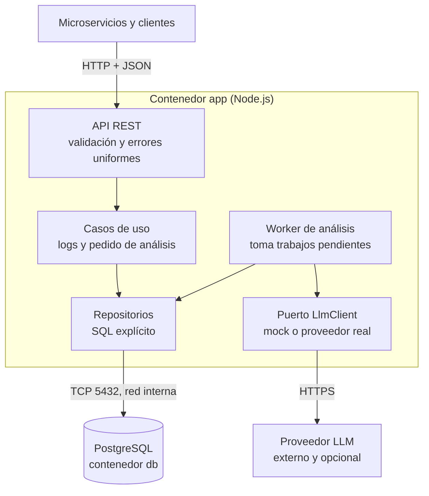
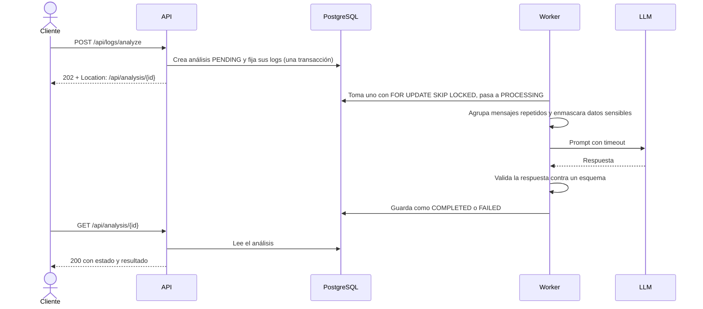
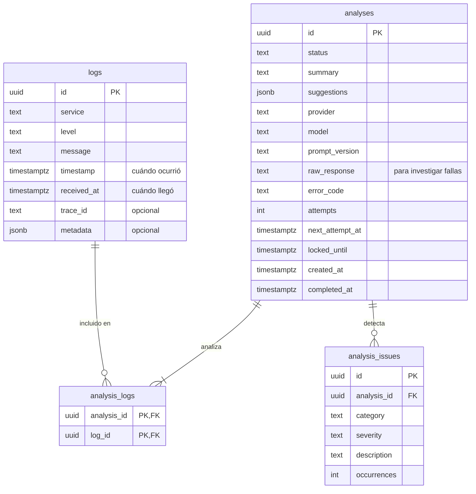

# Arquitectura de SmartLog Analyzer

Herramienta interna que recibe logs de varios microservicios, los almacena y usa un LLM para detectar patrones. Es un prototipo: las decisiones priorizan que funcione, que se pueda probar y que se pueda cambiar. Lo que haría falta para producción está en [Fuera de alcance](#fuera-de-alcance).

## Componentes

| Componente | Responsabilidad |
|---|---|
| API REST | Traduce HTTP: valida la entrada, llama a un caso de uso y da formato a la respuesta. No contiene reglas de negocio. |
| Casos de uso | Las operaciones del sistema: ingerir, listar, agregar y pedir un análisis. |
| Worker | Corre en el mismo proceso. Toma análisis pendientes, llama al LLM y guarda el resultado. |
| Repositorios | Todo el SQL. Nada fuera de esta capa conoce Postgres. |
| `LlmClient` | Interfaz con dos implementaciones, elegidas por `LLM_PROVIDER`. Nada fuera del adaptador conoce al proveedor. |

## Flujo de un análisis

Ingerir un log es directo: se valida, se guarda y responde `201`. Analizar es asincrónico:

Estados: `PENDING → PROCESSING → COMPLETED | FAILED`. Un error transitorio devuelve el análisis a `PENDING`, con fecha para el próximo intento.

## Decisiones técnicas

| Decisión | Elegido | Alternativa descartada | Por qué |
|---|---|---|---|
| Estructura | Monolito modular con puertos y adaptadores | Microservicios | Son dos flujos y un equipo; separarlos agrega red y despliegue sin beneficio. Los módulos permiten separar el worker si hiciera falta. |
| Lenguaje | TypeScript sobre Node.js | JavaScript puro | Los tipos hacen más seguro cambiar el código, y este servicio es sobre todo I/O. |
| Framework | Fastify | Express, NestJS | Express deja validación y logging a mano. NestJS agrega capas y decoradores que un servicio tan chico no aprovecha. |
| Análisis | Asincrónico: `202` y consulta posterior | Sincrónico | Un LLM tarda segundos y puede fallar. Si se corta la conexión, se pierde el trabajo ya pagado. |
| Cola de trabajos | Tabla en Postgres con `SKIP LOCKED` | RabbitMQ o Kafka; cola en memoria | Un broker agrega otro servicio para unos pocos trabajos. Una cola en memoria los pierde al reiniciar. |
| Base de datos | PostgreSQL con `JSONB` | Elasticsearch, ClickHouse, MongoDB, SQLite | Los dos primeros apuntan a un volumen mucho mayor. MongoDB no aporta si `JSONB` ya cubre la parte flexible. SQLite concurre mal con API y worker. |
| Acceso a datos | `pg` con SQL explícito | Prisma u otro ORM | Las consultas importantes (agregación, cursor, `SKIP LOCKED`) quedan más claras en SQL. |
| Migraciones | `node-pg-migrate` con SQL en `db/`, al arrancar | Migraciones del ORM; servicio aparte en compose | Sin ORM no aplican. Un servicio aparte recién se justifica con varias réplicas; la herramienta ya toma un lock. |
| Paginación | Cursor (`timestamp`, `id`) | `OFFSET` | `OFFSET` se degrada con el volumen y repite filas cuando entran logs nuevos. |
| Errores | RFC 9457 (`application/problem+json`) | Formato propio | Es un estándar y da una única forma para todos los errores. |
| Validación | Zod, también para la respuesta del LLM | Validación manual | Una sola herramienta para todo lo que entra de afuera, con tipos derivados. |
| Tests de integración | Postgres real con Testcontainers | `pg-mem` | Una simulación no prueba el comportamiento real de `SKIP LOCKED` ni de `JSONB`. |
| LLM simulado en tests | Servidor HTTP local | Mockear `fetch` | Prueba el timeout y las respuestas rotas a nivel de red. |
| LLM por defecto | Mock detrás de `LlmClient`, con un adaptador real | Solo proveedor real | `docker compose up` debe funcionar sin una API key. Proveedor del adaptador: a definir en la etapa 4. |
| Categorías de problemas | Tabla `analysis_issues` | `JSONB` dentro del análisis | Permite agregar: "qué problemas son más frecuentes". Las sugerencias sí van en `JSONB`, porque solo se muestran. |

## Modelo de datos

`analysis_logs` fija qué logs entraron en cada análisis, para que siga siendo reproducible aunque lleguen más. Los índices acompañan las consultas reales: `logs(timestamp, id)`, `logs(service, level, timestamp)` y un índice parcial sobre los análisis `PENDING`.

## API

| Método y ruta | Éxito | Errores |
|---|---|---|
| `POST /api/logs` | `201` con `Location` | `400` JSON inválido, `415` content type, `422` campos inválidos |
| `GET /api/logs` | `200` con `nextCursor` | `422` filtros inválidos, como `from > to` |
| `GET /api/logs/stats` | `200` con conteos por servicio y nivel | `422` rango inválido |
| `POST /api/logs/analyze` | `202` con `Location` | `422` sin logs, sobre el máximo, o ids y filtro a la vez |
| `GET /api/analysis/{id}` | `200` con estado y resultado | `400` id inválido, `404` no existe |
| `GET /api/health` | `200` | `503` si la base no responde |

- **`GET /api/logs/stats`** no estaba en los endpoints mínimos: expone la consulta de agregación.
- **Un análisis `FAILED`** responde `200`: la consulta funcionó y el fallo es parte del resultado.
- **`/api/health`** comprueba la base, pero no llama al LLM: costaría dinero, y si el proveedor cae se pueden seguir ingiriendo logs. Es el único endpoint que no usa RFC 9457: informa un estado, no un error del pedido, así que `200` y `503` comparten el mismo cuerpo.

## Integración con el LLM

Antes de llamar al proveedor:

1. **Agrupar.** Los mensajes se normalizan (números y UUID pasan a ser marcadores) y se agrupan con su conteo. Mil errores iguales son una línea: menos tokens y patrones más visibles.
2. **Enmascarar.** Tokens y emails se ocultan antes de salir hacia un tercero. Es un filtro básico por expresiones regulares, no una garantía.
3. **Delimitar.** Un log es texto no confiable y podría decir "ignorá tus instrucciones". Va marcado como datos, y la salida se valida contra un esquema y nunca se ejecuta.

El adaptador devuelve el resultado o un error tipado. Cada análisis guarda proveedor, modelo y versión del prompt.

## Qué pasa cuando algo falla

| Falla | Comportamiento | `error_code` final |
|---|---|---|
| Timeout del LLM | Hasta 3 intentos con espera creciente | `LLM_TIMEOUT` |
| `429` o `5xx` del proveedor | Hasta 3 intentos con espera creciente | `LLM_UNAVAILABLE` |
| Respuesta con formato inesperado | Hasta 2 intentos; se guarda `raw_response` | `LLM_INVALID_RESPONSE` |
| Otro `4xx` del proveedor, como `401` | Sin reintento | `LLM_REJECTED` |
| La app cae durante un análisis | Vence `locked_until` y otro ciclo lo retoma | `WORKER_INTERRUPTED` si agota los intentos |
| Cae la base de datos | La API responde error, `/api/health` da `503` y el worker sigue intentando | No aplica |
| `SIGTERM` | Deja de tomar trabajos, termina el actual y cierra conexiones | No aplica |

**Compromiso aceptado:** la entrega es *al menos una vez*. Si la app cae después de llamar al LLM y antes de guardar, ese análisis se llama dos veces. Cuesta poco y es preferible a perderlo.

## Contenedores

- **`docker compose up`** levanta `app` y `db` sin pasos previos. Las variables tienen valores por defecto de desarrollo, así que no hace falta crear un `.env`.
- **Orden de arranque:** `app` espera a que `db` esté sana, aplica migraciones y carga el seed, que es idempotente.
- **Red:** `app` publica su puerto al host. `db` queda solo en la red interna, porque los tests usan su propio contenedor. Para desarrollar, `docker-compose.dev.yml` la publica únicamente en `127.0.0.1`.
- **Imagen:** `node:26-slim` en vez de Alpine. Pesa algo más, pero el compilador de TypeScript 7 no publica binarios específicos para musl, la libc de Alpine, y Debian evita ese riesgo.

Los puertos y las variables se documentan en el `README.md`.

## Fuera de alcance

Se deja afuera a propósito y se resolvería así:

| Tema | Cómo lo resolvería |
|---|---|
| Autenticación | API keys por servicio para ingerir y OIDC para consultar |
| Ingesta por lotes | `POST /api/logs/batch` con resultado por ítem |
| Duplicados por reintentos del cliente | Header `Idempotency-Key` |
| Retención y volumen | Particionar `logs` por fecha y borrar particiones viejas |
| Rate limiting | En un gateway o reverse proxy |
| Reverse proxy | Se suma con TLS o varias réplicas; hoy no aporta |
| Interfaz web | Fuera de lo pedido: la herramienta se usa por API |
