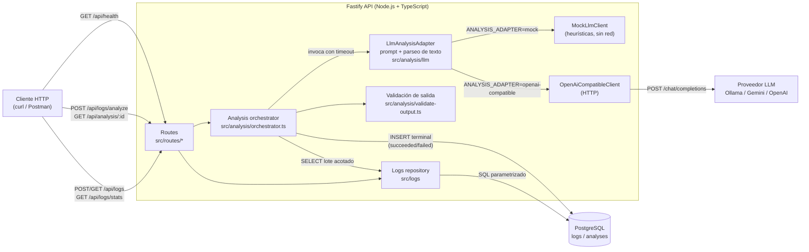
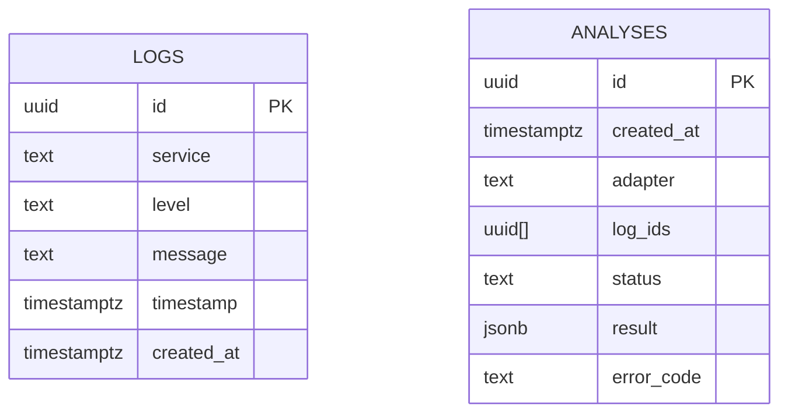

# ARCHITECTURE.md — SmartLog Analyzer

Prototipo interno para ingestar logs de varios microservicios, consultarlos y generar
análisis (resumen, categorías, sugerencias) a partir de un lote acotado, usando un
LLM detrás de una interfaz intercambiable (mock por defecto, proveedor real opcional).

> **Nota sobre el historial:** el primer commit del repo exploró un diseño
> asincrónico (cola con `SKIP LOCKED`, `202` + polling, errores RFC 9457). Se
> descartó a favor de un análisis síncrono con timeout acotado (ver §5). Esa
> exploración queda en la rama `stage-1-walking-skeleton`, sin mergear.

## 1. Componentes y flujo de datos



Puntos clave del flujo:

- **Ingesta y consulta** son operaciones simples sobre `logs`, sin pasar por el LLM.
- **Análisis** es síncrono: el cliente espera la respuesta HTTP con el resultado ya
  persistido (`201`) o el fallo ya persistido (`502`/`504`, con el ID consultable).
- **Solo el orquestador escribe en la base**, una única vez por intento aceptado. El
  adaptador y el cliente LLM nunca persisten nada. Así una respuesta tardía de un
  cliente que ignoró el `AbortSignal` no puede pisar un resultado ya guardado (§6).
- **Lo único que cambia entre mock y proveedor real es el `LlmClient`** (prompt →
  texto). Construcción del prompt, parseo, validación, timeout y persistencia son
  el mismo código en ambos casos, así que los tests de "formato inesperado" ejercen
  lo mismo que enfrentaría un modelo real.

## 2. Modelo de datos



- `logs.level` restringido por `CHECK` a `DEBUG | INFO | WARN | ERROR`.
- `logs.timestamp` es `timestamptz`: se recibe con offset explícito y se devuelve en UTC.
- `analyses.status` restringido a `succeeded | failed`. No hay estado `pending`: el
  endpoint es síncrono, así que la fila se crea cuando el intento ya terminó.
- `analyses.log_ids` guarda los IDs exactos del lote analizado (≤100), para auditar
  qué evidencia sustenta un resultado sin tabla intermedia (ver §5).
- `analyses.result` es `JSONB` si `status = 'succeeded'` y `NULL` si `failed`; en ese
  caso `error_code` guarda un código seguro (`ADAPTER_ERROR` | `ADAPTER_TIMEOUT` |
  `INVALID_ADAPTER_OUTPUT`), nunca el mensaje crudo del proveedor. Un `CHECK`
  garantiza esa combinación a nivel base.
- `analyses.adapter` registra qué cliente produjo el resultado (`llm:mock-v1`,
  `llm:openai-compatible:<modelo>`).
- Índices: `logs(service, level, timestamp DESC)` para filtros combinados y la
  agregación; `logs(timestamp DESC, id DESC)` para el listado sin filtros;
  `analyses(created_at DESC)` para un futuro listado de análisis.

## 3. Contrato HTTP

| Método | Ruta | Éxito | Errores |
|---|---|---|---|
| `POST` | `/api/logs` | `201` + log creado | `400` validación |
| `GET` | `/api/logs` | `200` + lista (incluso vacía) | `400` filtros inválidos o rango invertido |
| `GET` | `/api/logs/stats` | `200` + conteo por servicio/nivel y total | `400` rango faltante, inválido o invertido |
| `POST` | `/api/logs/analyze` | `201` + resultado + header `Location` | `400` validación/rango, `422` lote vacío o excedido, `502` error o salida inválida del LLM, `504` timeout |
| `GET` | `/api/analysis/:id` | `200` (succeeded o failed) | `400` ID inválido, `404` no existe |
| `GET` | `/api/health` | `200` base ok | `503` base no responde |

Reglas transversales:

- Errores siempre `{ "error": { "code", "message" } }`, sin stack traces ni detalles
  internos del proveedor o de PostgreSQL. Los errores de validación agregan
  `details: [{ field, message }]` con el campo que falló.
  `POST /api/logs/analyze` fallido agrega `analysisId` al mismo sobre.
- Timestamps: ISO 8601 con offset obligatorio (`Z` o `±HH:MM`), hasta milisegundos.
  Se rechazan fechas de calendario inexistentes (30 de febrero).
- Rangos: intervalo semiabierto `[from, to)`. `from >= to` es `400 INVALID_RANGE`, no
  una lista vacía: un rango invertido es un error del cliente, no "no hay datos".
- `service` y `message` no pueden ser solo espacios ni contener el byte NUL
  (PostgreSQL lo rechaza en columnas `text`; sin la validación terminaba en `500`).
- `GET /api/logs`: filtros `service`, `level`, `from`, `to`, `limit` (default 50,
  máximo 500). Orden `timestamp DESC, id DESC` (estable aun con timestamps repetidos).
- `GET /api/logs/stats`: `from` y `to` obligatorios, para no permitir un `GROUP BY`
  sobre toda la tabla.
- `POST /api/logs/analyze`: `from`/`to` obligatorios, `service`/`level` opcionales. Se
  seleccionan hasta 101 filas con el mismo orden del listado: si existe la 101, el
  lote excede el límite de 100 y se responde `422` sin llamar al LLM. También `422`
  si el lote está vacío o si su tamaño serializado supera `ANALYSIS_MAX_BYTES`.

## 4. Integración con el LLM

```ts
interface LlmClient {                 // lo único específico de cada proveedor
  readonly name: string;
  complete(prompt: { system: string; user: string }, signal: AbortSignal): Promise<string>;
}
```

`LlmAnalysisAdapter` (implementa `AnalysisAdapter`) hace tres cosas:

1. **Construye el prompt** (`llm/prompt.ts`). Las instrucciones van en el mensaje de
   sistema, fijo. Los logs van en el mensaje de usuario como JSON
   (`{"logs":[{id, service, level, timestamp, message}]}`), nunca concatenados a la
   instrucción, y el sistema le indica al modelo que todo eso es dato. Así un
   `message` con "ignore previous instructions" sigue siendo un string.
   Antes de salir del proceso se enmascaran emails, tokens `Bearer` y pares
   `password=`/`token=`/`api_key=`.
2. **Llama al `LlmClient`** con el `AbortSignal` del orquestador.
3. **Parsea el texto** (`llm/parse-response.ts`). Acepta JSON plano o envuelto en un
   bloque ```` ```json ````, que es la desviación más común de los modelos. Todo lo
   demás (prosa, JSON truncado, respuesta vacía) es `INVALID_ADAPTER_OUTPUT`.
   Intentar "rescatar" JSON de una respuesta en prosa esconde fallas reales del modelo.

Después, el orquestador **valida la salida contra el lote** (`validate-output.ts`):
tipos, cantidades máximas, y que cada `evidenceLogIds` pertenezca al lote enviado. Un
ID inventado por el modelo es salida inválida (`502`). Es la segunda barrera contra
prompt injection: aunque el modelo "obedezca" a un log, lo que no respete el esquema
no se persiste.

Clientes disponibles, elegidos con `ANALYSIS_ADAPTER`:

- **`mock` (default)** — `MockLlmClient`: lee los logs del mensaje de usuario, aplica
  heurísticas deterministas (`heuristics.ts`, reglas por patrón sobre WARN/ERROR) y
  devuelve la respuesta como texto JSON, igual que un proveedor. `docker compose up`
  funciona sin red ni API key y la demo es reproducible.
- **`openai-compatible`** — `OpenAiCompatibleClient`: `POST {LLM_BASE_URL}/chat/completions`
  con `temperature: 0` y `response_format: json_object`. Un solo cliente cubre Ollama
  (local, gratis), Gemini (free tier, vía su endpoint compatible) y OpenAI. Reenvía el
  `AbortSignal` a `fetch`, así que el timeout cancela la request HTTP de verdad. Ante
  un status no-2xx lanza un error con el código HTTP solamente: el cuerpo del
  proveedor puede contener partes del prompt.

## 5. Decisiones técnicas y alternativas descartadas

| Decisión | Alternativa descartada | Motivo |
|---|---|---|
| Node.js 24 + TypeScript + Fastify 5 | Java + Spring Boot | Más velocidad de desarrollo para 10–15 h. Fastify trae validación por JSON Schema sin el boilerplate de Spring. |
| PostgreSQL 17 + `pg` con SQL parametrizado | Prisma/TypeORM, o SQLite | SQL explícito hace auditable cada query. Postgres da `timestamptz`, `jsonb`, arrays y `CHECK`s que el modelo usa. SQLite se acerca menos a lo que correría en producción. |
| Monolito modular (`logs` / `analysis`) | Microservicios separados | Un prototipo de 6 endpoints no justifica la complejidad de red y despliegue. La separación por módulo alcanza para testear cada pieza. |
| Análisis síncrono con timeout | Cola (BullMQ/SQS) + worker, `202` + polling | La cola es más robusta con proveedores lentos, pero agrega estado `pending`, locking y polling. Se exploró y se descartó por tiempo. Es la evolución natural si un modelo real tarda decenas de segundos. |
| `LlmClient` que devuelve texto + adaptador que parsea | Mock que devuelve el objeto ya armado | La primera versión del mock devolvía el objeto final, y el parseo de una respuesta real (prosa, fences, JSON truncado) no tenía código ni tests. Con la separación, mock y proveedor real recorren el mismo parser y validador. |
| Un cliente OpenAI-compatible | Un SDK por proveedor (OpenAI, Anthropic, Gemini) | Una sola implementación con `fetch` cubre Ollama local, Gemini gratis y OpenAI, sin dependencias nuevas. Un SDK específico se justifica si se necesitan features propias (tool use, streaming). |
| Parser estricto (solo tolera fences) | Extraer "el primer `{...}`" de cualquier respuesta | Ser permisivo esconde fallas del modelo y puede tomar el JSON equivocado. Con `response_format: json_object` la prosa es rara. |
| `analyses.result` como `JSONB` + `log_ids uuid[]` | Tablas normalizadas por categoría/sugerencia y tabla intermedia `analysis_logs` | El resultado siempre se lee completo por ID. Un array de ≤100 IDs es más simple que una tabla intermedia. Si se agrega borrado de logs, se revisa (el array no tiene integridad referencial). |
| Timeout propio (`setTimeout` + `Promise.race`) | Confiar solo en `AbortSignal` | El timeout tiene que cumplirse aunque el cliente ignore la señal. Se propaga el `AbortSignal` igual (el cliente HTTP lo respeta), pero el temporizador es la garantía. |
| Vitest | Jest | TypeScript y ESM nativos sin `ts-jest`/Babel. API compatible con Jest. |
| Tests de integración contra PostgreSQL real | Mock de la base | Los `CHECK`, `jsonb`, arrays y `timestamptz` son parte de lo que se prueba. Un mock no los reproduce. |
| Solo `limit`, sin paginación por cursor | Cursor/keyset pagination | La letra pide "listar con filtros". `limit` acotado + orden estable alcanza para el prototipo. |
| Errores propios `{error:{code,message,details?}}` | RFC 9457 (`application/problem+json`) | Más chico de implementar y testear. RFC 9457 es la mejora natural si la API crece. |
| Runner de migraciones propio (~40 líneas) | `node-pg-migrate` | Solo hace falta aplicar SQL versionado en orden y no duplicar. Rollbacks y CLI son superficie que el alcance no necesita. |
| CI con GitHub Actions (tests + `docker compose up`) | Sin CI | Corre typecheck y tests contra Postgres, y comprueba de forma automática que `docker compose up` levanta todo sin pasos extra. |

## 6. Fallos y reintentos

- **El proceso cae entre el `SELECT` del lote y el `INSERT` terminal:** no queda fila
  en `analyses` (no hay estado `pending`). El cliente ve un error de red. Reintentar es
  seguro: no hay duplicado posible.
- **El cliente repite el `POST` tras perder la respuesta, pero el servidor sí había
  persistido:** se crean dos filas para el mismo lote (no hay idempotencia). Solución
  natural: header `Idempotency-Key` con `UNIQUE` en `analyses`.
- **Falla la escritura en PostgreSQL** (no el LLM): `500` sin ID, porque no se puede
  prometer que el resultado sea consultable. Distinto de un fallo del LLM (`502`/`504`),
  que sí se persiste y expone su ID.
- **El LLM responde después del timeout:** el orquestador ya respondió `504` y ya hizo
  su único `INSERT`. La respuesta tardía se descarta sin persistir ni loguear. El fallo
  del adaptador (error o salida inválida) sí se loguea del lado servidor con su causa,
  sin exponerla al cliente.
- **La base no responde:** `GET /api/health` devuelve `503` dentro de
  `HEALTH_DB_TIMEOUT_MS`. El timeout de la consulta se aplica con `SET LOCAL` dentro
  de una transacción para no quedar pegado a la conexión del pool.

## 7. Requisito → implementación → verificación

| Requisito | Dónde | Cómo se verifica |
|---|---|---|
| Diagrama + decisiones | §1 y §5 | — |
| Modelo de datos, migraciones, seed | `db/migrations/*.sql`, `db/seed.ts` | `tests/integration/startup.test.ts` (migrar y re-seed sin duplicados) |
| Consulta de agregación | `aggregateByServiceAndLevel` + `GET /api/logs/stats` | `tests/integration/logs-aggregation.test.ts` |
| Endpoints, validación, errores | `src/routes/*`, `src/app.ts` | `tests/integration/logs.test.ts`, `analysis.test.ts`, `error-handling.test.ts`, `health.test.ts` |
| LLM: resumen, categorías, sugerencias | `src/analysis/llm/*`, `heuristics.ts` | `tests/unit/llm-*.test.ts`, `heuristics.test.ts` |
| LLM: respuesta válida / formato inesperado / timeout | `parse-response.ts`, `validate-output.ts`, `run-with-timeout.ts` | `tests/integration/analysis.test.ts` ("through the LLM adapter"), `tests/unit/run-with-timeout.test.ts` |
| Cliente de proveedor real | `openai-compatible-client.ts` | `tests/integration/openai-compatible-client.test.ts` (servidor HTTP falso local) |
| Persistencia de cada análisis | `src/analysis/repository.ts` | `tests/integration/analysis.test.ts` |
| `docker compose up` sin pasos extra | `Dockerfile`, `docker-compose.yml`, `docker/entrypoint.sh` | Job `compose` de `.github/workflows/ci.yml` |

## 8. Fuera de alcance

UI, cola/worker asíncrono, reverse proxy, documentación OpenAPI, paginación por
cursor, idempotencia de `POST /api/logs/analyze`, listado de análisis, retención de
logs. Ver README, "Qué quedó afuera".
